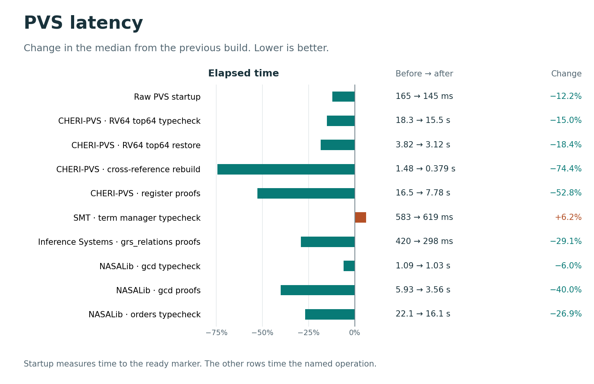
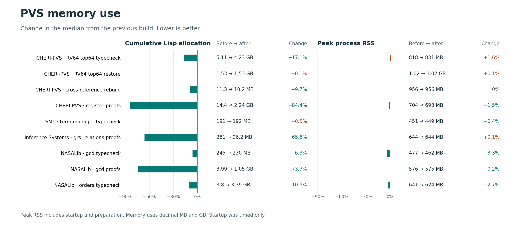
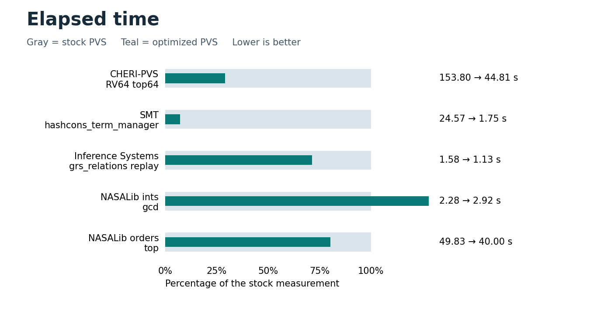
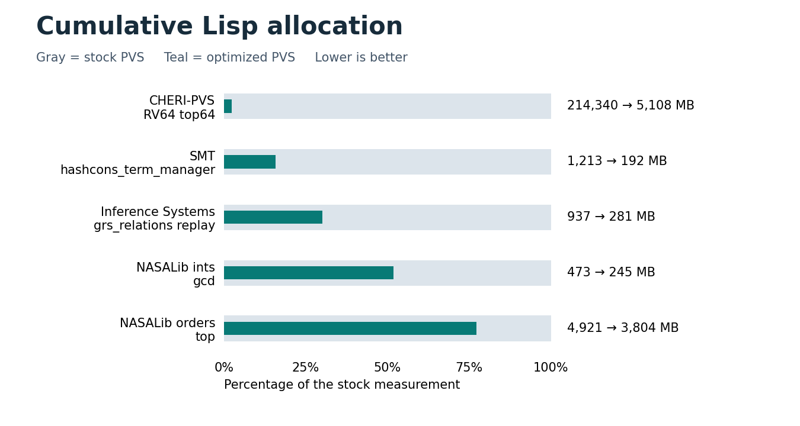
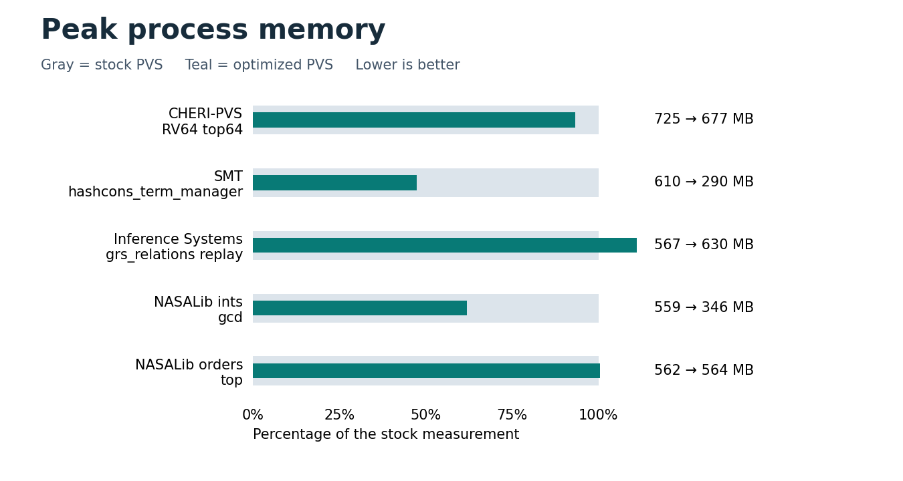

# PVS performance on deployed libraries

The [combined core source patch](patches/pvs-core.patch) contains both optimization passes against `e185d56e`. The [ranked review series](patches/series/README.md) splits it into individual patches with before-and-after measurements. The changes are already applied in this checkout. The optional [MCP extension](../../agent/) is a separate working-tree directory.

## Startup, file processing and proof replay

These figures compare the image produced by the first optimization pass with the rebuilt image containing the subsequent startup, datatype, library lookup, binary reader, cross-reference and prover changes. Both ran on the same Apple Silicon machine on 2026-11-04 with SBCL 2.6.5-85913ede1. Trials used separate processes and disposable project directories. The filesystem cache was warm. [Individual trials](round2-results.json)





Median startup time fell from 165 to 145 ms. CHERI's cold RV64 typecheck fell from 18.29 to 15.55 s, and opening the same tree from binaries fell from 3.82 to 3.12 s. Regenerating the cross-references took 0.38 s versus 1.48 s. The five CHERI register proofs took 7.78 s versus 16.46 s and allocated 2.24 GB versus 14.36 GB.

NASALib's `orders/top` typecheck fell from 22.10 to 16.14 s. The 60 `ints/gcd` proofs fell from 5.93 to 3.56 s and from 3.99 to 1.05 GB allocated. Inference Systems replayed its seven proofs in 298 ms versus 420 ms. SMT's term-manager stage rose from 583 to 619 ms. CHERI's cold typecheck allocated 17% fewer bytes, while its median peak RSS rose from 818 to 831 MB.

Startup runs launched quiet raw PVS in an empty directory with the user configuration and patches disabled. The clock started before launching the process and stopped when PVS evaluated its first command. Source typechecks started without PVS binaries. The cached CHERI workload read the same 39 previously saved theories in both images. Each proof workload timed forced replay after preparation. The five CHERI register scripts closed their local goals and retained their original `proved - incomplete` dependency status. The other replay workloads covered all 60 NASALib `ints/gcd` formulas and all seven Inference Systems `grs_relations` formulas.

The SBCL image now initializes ASDF registries on first use and sets the prelude context paths from one directory lookup. Library discovery stops at the first eligible source file in each directory. The binary reader reads directly into its word vector and still handles opposite-endian files. Datatype generation parses an identity map only when a generated term needs it. Cross-reference generation uses an identity table for large declarations and reuses bounded tables within a module. SBCL interprets short-lived Lisp expressions in proof strategies. Custom strategy Lisp that inspects evaluator mode or tests whether a returned closure is compiled can observe that change. The interactive worker hashes files in chunks and fingerprints each physical source file once per preparation.

In an isolated cross-reference rebuild of CHERI, the median went from 2.68 to 0.74 seconds and from 11.56 to 10.30 MB allocated. The ordered references matched by object identity across 5,773 declarations, 128,474 edges and 1,973 standalone expression walks. A cold typecheck produced the same TCC text as a restore of all 39 cached theories. Nested cotuple and union datatypes also produced identical generated PVS source.

Sampling the preceding image put library directory probes on 26% of NASALib `orders/top` typecheck stacks and strategy expression evaluation on 43% of the CHERI register replay stacks. In a cached CHERI load, 69% of samples included the generic `restore-object*` traversal, where CLOS dispatch and object-identity lookups remain expensive. After deferring unused datatype maps, the syntax constructor's `initialize-instance :around` method appeared on 0.7% of the cold `top64` samples. Fresh-process tests measured about 20 ms loading the three native libraries at startup.

The preceding image had SHA-256 `f3ab09dbefc90b64b8f861dc8214448e5917ac74a8af8f8576a807126a1e6b3a`. The rebuilt image had SHA-256 `5dd884694edac3964bd104caf2d8f6bc16258342c2f6af0207dbfc06ebb55c3a`. Startup uses the medians of 25 runs per image. Other rows use three runs per image. Each library workload produced the same declaration and TCC signature on both builds. The replay cases also matched proof statuses, and the cross-reference case matched ordered target signatures. Elapsed time and peak RSS vary with host load. RSS includes startup and preparation, while cumulative allocation covers only the named operation.

## Original stock comparison

The figures compare the saved stock SBCL image with the rebuilt checkout on the same Apple Silicon machine. Each bar shows the optimized measurement as a percentage of stock. The labels give absolute values. Lower is better in all three figures.







CHERI allocated 214.34 GB with the stock image and 5.11 GB with the optimized image. The SMT stage fell from 24.57 to 1.75 seconds. Inference Systems replayed seven proofs in 1.13 seconds versus 1.58 seconds, although median process peak memory rose from 567 to 630 MB.

NASALib's orders root fell from 49.83 to 40.00 seconds and from 4.92 to 3.80 GB allocated. The integers workload fell from 473 to 245 MB allocated but took 2.92 seconds versus 2.28 seconds. Its peak memory fell from 559 to 346 MB.

### Workloads

| Workload | Timed operation |
| --- | --- |
| CHERI-PVS | Cold source typecheck of the RV64 import root, `top64`. |
| SMT | Typecheck `hashcons_term_manager` after loading `ics_types` and `ics_semantic_nodes`. |
| Inference Systems | Force replay of all seven `grs_relations` proofs after preparing six source files. |
| NASALib integers | Cold source typecheck of `ints/gcd` including its imports. |
| NASALib orders | Cold source typecheck of the `orders/top` import root. |

Each trial starts a fresh process on an isolated copy of the source and proof files without binary caches. Time and bytes allocated cover the indicated operation. Peak RSS is the process high-water mark up to the end of that operation, so it includes startup and preparation. The figures use medians of three trials per configuration, except CHERI, which has one per configuration. Runs took place on a shared host. Wall times can vary with machine load.

The harness requires successful typechecking and hashes theory IDs, declaration counts, and unparsed TCC definitions. The proof workload also requires every replayed declaration to be proved and includes its status in the hash. Every stock/patched pair must have the same signature. These checks cover the selected entry points, not the entire NASALib distribution or all proof dependencies.

The checkout source baseline was `e185d56e`. Its bundled stock image had SHA-256 `4b9326bc73f0654b0464718803c4fa680110635bd2a4214ffcc7d4d622af05d2`. The rebuilt image used SBCL 2.6.5-85913ede1. Deployment inputs were the local CHERI-PVS tree at `becdecd`, Inference Systems at `6bf26d5`, NASALib at `57b5a43b`, and the local SMT source directory. The measured optimized image had SHA-256 `d731028976f053e541c820d3c159765f2df960c40d43a90a0cfa7d7d71c4455a`. Two subsequent startup fixes recreate discarded deserialization buffers and handle missing imported directories when reading old contexts. The plotted trials start without saved binary contexts. The final image restored all 39 newly cached CHERI theories in a fresh process and reproduced the cold TCC text byte-for-byte. Older, version-mismatched binaries use PVS’s existing source-recheck path. Raw measurements and signatures are in [results.json](results.json).

### Implementation choices

- Each lexer stream stores only explicit character rules. Ordinary keyword and projection checks avoid permanently interning uppercase copies of identifiers.
- AST walks borrow one small visited table within a typecheck. Nested walks have independent tables, and tables above capacity 512 are discarded.
- Theory discovery filters candidates in Lisp and uses the PVS parser to decide matches and clashes. Proofs start with an empty private substitution table. Shostak compares symbol names directly.
- The binary reader fills proper lists in one pass, tracks active references by identity, clears scratch references on exit, and recreates scratch buffers on the first read after image startup. The writer checks for prelude references before querying filesystem identity.
- PVSio resolves each distinct theory once per attachment purge. The MCP client indexes journaled transcript events on disk and retains events in memory if a write fails.

The constructor method-combination experiment was excluded because its direct initialization return value and CLOS extension order differ from the original. The empty proof cache supersedes the alternative that defers copying parent tables.

## Individual changes, ranked by time saved

These A/B tests compare one change, or the named group, on a representative operation. Rows are ordered by seconds saved per operation. The tests have different baselines and workloads, so the savings cannot be added. Allocation means cumulative allocation during the operation. The complete-build figures above are separate trials.

| Rank | Change and operation | Time before → after | Other measured effects |
| ---: | --- | --- | --- |
| 1 | Sparse Unicode lexer tables, CHERI cold `top64` | 110.51 → 43.49 s | 214.30 → 4.93 GB allocated. The stock arm had one trial. |
| 2 | Scope the `mapobject` visited table to each AST walk, after the lexer change | 43.49 → 18.19 s | Fresh tables raised allocation from 4.93 to 5.79 GB. In a separate pair, reusing tables of at most 512 slots reduced 5.80 to 5.02 GB at essentially the same time (16.33 → 16.43 s). |
| 3 | Interpret short-lived Lisp strategy forms, five CHERI register proofs | 42.15 → 17.37 s | 14.36 → 2.24 GB. The same change took NASALib's 60 `gcd` proofs from 12.97 to 6.72 s and 3.99 to 1.05 GB. |
| 4 | Filter theory-discovery candidates before parsing, SMT term-manager stage | 14.70 → 0.73 s | 1.12 GB → 230 MB. Two trials per arm. The parser still decides matches and clashes. |
| 5 | Reuse the canonical prelude directory and stop at the first eligible source when discovering libraries, NASALib `orders/top` | 41.07 → 32.63 s | 3.75 → 3.34 GB. On `ints/gcd`, allocation fell 5.8% while isolated median time rose from 3.20 to 3.34 s. |
| 6 | Check for prelude objects before filesystem identity queries, forced save of 39 CHERI theories | 6.05 → 1.76 s | 456 → 52 MB. File-information calls fell from 296,172 to 954. The saved binaries matched byte-for-byte. |
| 7 | Defer parsing identity maps until a generated datatype term uses them, CHERI cold `top64` | 46.58 → 42.41 s | Midpoints of two trials per arm. The individual pairs saved 5.07 and 3.28 s. Allocation fell from 5.07 to 4.20 GB. |
| 8 | Track objects on the active binary-restore path by identity, cached CHERI load | 6.37 → 3.37 s | 1.63 → 1.54 GB. Live heap growth after GC was about 345 MB in both arms. |
| 9 | Use bounded identity tables for large cross-reference walks, in-process CHERI rebuild | 2.68 → 0.74 s | 11.56 → 10.30 MB. All 128,474 ordered edges matched. |
| 10 | Read binary words in bulk on SBCL, cached CHERI load | 7.62 → 6.59 s | Isolated reader prototype. The final portable reader is included in the complete-build comparison of 3.82 → 3.12 s. |
| 11 | Start proofs with an empty private substitution cache, seven Inference Systems proofs | 1.46 → 0.92 s | 842 → 813 MiB. Allocation on the five large CHERI proofs was essentially unchanged by this change alone. |
| 12 | Pre-size copies of linked hash tables, VSTTE12 `top` | 818 → 789 ms | 822.0 → 820.1 MB. Small timing difference. |
| 13 | Lazy ASDF registry setup, one prelude path resolution, and less launcher overhead, raw startup | 165 → 145 ms | Combined result, 25 launches per image. There is no separate end-to-end number for each launcher edit. |
| 14 | Skip library lookup for known prelude theories during judgement instantiation, VSTTE12 `top` | 574 → 555 ms | 182 → 0 library lookups. Timing ranges overlapped. |
| 15 | Compare Shostak symbol names directly, full 64-variable proof | 420 → 406 ms | 756 → 733 MB. A synthetic 2,048-symbol sum took 249 → 41 ms and 201 MB → 98 KB. |
| 16 | Resolve each PVSio attachment theory once per purge, warm evaluator reopen and check | 15.2 → 4.2 ms | 5.07 → 0.85 MB. A three-expression workload made 12 parse calls versus 111. |
| 17 | Hash MCP sources in chunks using a reusable buffer and deduplicate physical files, CHERI | 7.7 → 4.2 ms per validation | Derived from batches of three. Registration averaged 8.5 → 6.5 ms per call. All 39 paths in this fixture were distinct. |

### Scaling, retained memory and correctness

- Filling a decoded list in one pass took 57.7 → 3.54 ms on a generated 10,000-entry context. Existing `bitvectors` and `finite_sets` contexts showed little timing difference.
- Avoiding interning uppercase copies of ordinary identifiers prevented 6,000 extra permanent symbols for 3,000 mixed-case names across the PVS and SBST packages.
- Clearing stale references in both binary fetch buffers released about 1 MB after GC on a 756 KiB fixture. Recreating those buffers on first use lets a newly started image restore a workspace.
- The MCP client keeps offsets for successfully journaled events and retains event data if journaling fails. For 4,000 distinct 8 KiB replies, the current client's in-memory and journaled modes retained 32.35 and 0.40 MiB of traced Python heap after GC. The tail of the transcript remained readable.
- Library paths are initialized before restoring a workspace. Missing imported directories invalidate the affected saved entries so PVS can recheck source. The bulk reader handles opposite-endian input, rejects truncated files and uses a byte range compatible with older SBCL releases. These correctness checks have no independent timing claim.

## Reproduction

From the repository root, run each command with the stock and optimized executables, writing to separate output files.

```sh
python3 doc/performance/benchmark.py ./pvs cheri ~/git/CHERI-PVS/pvs cheri.json --repeats 1
python3 doc/performance/benchmark.py ./pvs smt ~/projects/misc/PVS/autoformalization/smt smt.json
python3 doc/performance/benchmark.py ./pvs inference ~/projects/misc/PVS/inference-systems inference.json
python3 doc/performance/benchmark.py ./pvs ints ~/git/PVS/nasalib ints.json
python3 doc/performance/benchmark.py ./pvs orders ~/git/PVS/nasalib orders.json
```

Use the same project sources for both executables. Place the resulting arrays under each workload's `stock` and `patched` keys in `results.json`. Run `python3 doc/performance/plot.py` with Matplotlib installed to regenerate the figures.

For the second pass, also run the following cases with both executables.

```sh
python3 doc/performance/benchmark.py ./pvs startup . startup.json --repeats 25
python3 doc/performance/benchmark.py ./pvs cheri-restore ~/git/CHERI-PVS/pvs restore.json
python3 doc/performance/benchmark.py ./pvs cheri-xref ~/git/CHERI-PVS/pvs xref.json
python3 doc/performance/benchmark.py ./pvs cheri-proof ~/git/CHERI-PVS/pvs registers.json
python3 doc/performance/benchmark.py ./pvs ints-proof ~/git/PVS/nasalib gcd-proofs.json
```

The cached CHERI cases build a disposable `top64` cache before timing by default. To reuse the same binaries across images, pass `--binary-cache DIR` with a matching source tree's `.pvscontext` and `pvsbin/`. The cross-reference case clears and rebuilds the graph and hashes each declaration's ordered targets, including their source positions. The measured proof input used the deployed register proof scripts with regenerated dependency annotations. Group trials by workload and image under the `before` and `after` keys in `round2-results.json`, then run `python3 doc/performance/plot_round2.py`.

`check_core.lisp` exercises Unicode parsing, traversal reentrancy, binary list restoration, opposite-endian and truncated inputs, Shostak symbol comparison, strategy evaluation, and cross-reference traversal. Load it with `pvs -q -raw -L /absolute/path/to/check_core.lisp` in a disposable directory.
