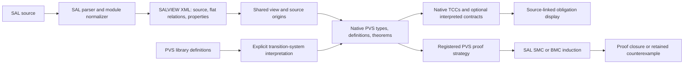

# Architecture and implementation plan

## Shared transition-system view

A machine is represented by ordinary PVS types and functions:

- `State`: a native record (array fields are native PVS functions).
- `defined(s)`: simultaneous SAL DEFINITION constraints.
- `initial(s)`: `defined(s)` and SAL's initialization relation.
- `step(s,next)`: both definition constraints and SAL's transition relation.
- `idle(s,next)`: SAL's skip relation, kept separately for composition.

`idle` is SAL's internal composition skip, which does not frame GLOBAL variables;
it must not be mistaken for equality of complete states.

The Lisp `sal-transition-view` also holds the original resolved SAL context,
normalized SAL AST, dependency contexts, formal/actual parameters, selected
properties, source places, generated declarations, and exact source snapshots. This metadata supports compilation and presentation;
it is **not** a syntax interpreter inside the PVS logic.

`SAL_Transition_System[State, initial, step]` supplies finite-prefix reachability,
invariants, infinite paths and satisfaction. Finite-prefix reachability includes
reachable terminal states. General X/G/F/U formulas use infinite paths, whose
interpretation at deadlocks differs from finite-prefix safety; they are rendered
but are not currently admitted by the model-checker proof rule. No stuttering
transition is silently inserted.

## Elaboration boundary

`tools/sal-view-export.scm` runs inside an existing SAL process. It uses SAL's
parser, well-formedness checking, module normalization, and assertion rebinding.
The exporter disables trace-only choice instrumentation and does not invoke
backend data flattening. SAL therefore owns composition wiring, implicit frames,
renaming and indexed composition. The version-2 XML envelope carries dependency contexts in dependency order,
context actuals, module formals, assignment target types, and source filenames
and positions that the legacy serializer otherwise loses. Local serializer
overrides repair missing normalized-node cases without modifying SAL itself.

`view-import.lisp` resolves the exported terms into the branch's existing SAL
CLOS AST. `elaborate.lisp` translates these terms to readable PVS. Names use an
injective encoding, and variable references follow resolved declaration identity,
not identifier spelling. Unsupported forms fail with an elaboration error.

The root context and its dependencies become separate native PVS theories with
type/value parameters. References use qualified theory instances. A generic
module adds its formal parameters to the machine theory; a concrete selector is
instantiated by SAL before normalization. A library-only context emits only its
declarations. Dependency discovery precedes snapshotting and semantic export,
so an imported file cannot change unnoticed between discovery and use.
Before flattening, the exporter also records typed checks for module and context
actual arguments. These include unused arguments, indexed composition binders,
explicit concrete selections, and unused context aliases. Their PVS checks live
in the declaring context or selected view, without introducing extra imported
namespaces. Thus normalization cannot erase a parameter-domain obligation.

Indexed composition currently goes through SAL's normalization into quantified
relations and array state. It does not require a first-class PVS theory per
component and it does not enumerate the finite index carrier. Preserving the
hierarchical module structure for presentation and compositional proofs is a
later optimization; the normalized view remains the semantic interface. Long conjunctions are
balanced, and total Boolean/real LET chains at relation scope become small
tuple-valued helper definitions with source origins. Subtype bindings, partial
operations, array accesses, and expressions under local guards retain their
original scope. These helpers preserve expression sharing and bound the nesting
depth without asking PVS to repeat very wide state binders for every Boolean gate.

## Typechecking and source obligations

The operational relation alone is insufficient to check SAL assignments: PVS
can compare a subtype value and a base-type expression using a common supertype.
The compiler therefore emits separate, guard-conditioned typed LET declarations
for deterministic assignments. Each nondeterministic branch is checked
independently; preceding alternatives never become priority guards. Assignments
are not used as assumptions to justify their own right-hand sides.

PVS generates its ordinary subtype, application and other TCCs. A source map
associates generated declarations and TCCs with SAL expressions and locations.
This first implementation presents the SAL expression next to the real PVS
formula. It does not textually substitute names into arbitrary proof terms or
pretend every prover-generated expression has a SAL source equivalent.
PVS may subsume duplicate obligations. Synthesized parameter checks retain the
original call-site location, while their displayed expression is a generated
SAL typed LET; the original resolved source context remains in the view.

Two optional companion theories add semantic obligations through **theory
interpretation**:

1. `SAL_Progress_Contract` maps initialization and reachable-state seriality axioms
   onto the machine, producing mapped-axiom TCCs. Empty initialization is exposed
   separately. Open-component environment assumptions need an explicit future
   contract interface; global seriality is not input receptiveness.
2. `SAL_Causality_Contract` maps a finite definition-dependency graph and requires
   a natural-valued rank decreasing along each dependency. This is a conservative
   structural scheduling criterion. A cycle may still have zero, one or multiple
   relational fixed points. Existence/uniqueness and conditional causality are
   different contracts and are not silently identified with this one.

These companions do not inject progress or causality assumptions into the main
machine theory. Safety proof admission consequently does not require their TCCs.
Their mapped obligations must still be proved before those contracts are claimed.

## Proof integration and trust

`backend.lisp` invokes SAL with fixed argument vectors and retains command,
version, source identity, exit status, stdout and stderr. A semantic result parser
distinguishes proof, bounded search, induction failure, counterexample, deadlock,
error and unknown output. A successful process exit is not a theorem.

`strategies.lisp` registers only generated `G(state predicate)` invariants. It
binds the exact typechecked declaration, generated source and semantic library,
SAL input/configuration, and native typing dependencies. The proof rule checks
that the original positive singleton goal and all captured sources still match,
and requires complete typing TCC proofs. Proof files can replay after reimport
and registration. A rejected check leaves the goal unchanged.

The trusted computing base currently includes this frontend, its admission checks,
PVS, and the selected SAL checker. SMC and finite BMC induction are admitted;
infinite BMC is available diagnostically but is not admitted for proof closure
because subtype-loss paths need a separate audit. Proof-producing SAL output and
PVS evidence checking are explicitly deferred.

## PVS libraries and the reverse direction

`SAL_Transition_View` is an interpretation interface over the same semantic
theory. A native PVS library defines the state, initial predicate and step
relation; an interpretation maps those definitions into the interface. Its
invariant theorem is the proof target. A direct parameterized import of
`SAL_Transition_System` is equally supported.

`pvs-origin-view.lisp` recovers the semantic instance from the typed theorem,
unfolding definitional wrappers with PVS's native instance substitution. It
recognizes the actual unchanged canonical invariant declaration, never just its
printed name. `pvs-to-sal.lisp` specializes the used definitions and admits a
finite exact fragment, then emits a shallow SAL relation. The initial-state and
successor sets retain subtype predicates and terminal states. This direction
does not create a second PVS encoding or enumerate reachable states.

`pvs-origin.lisp` captures the source and native TCC closure, validates the emitted
SAL with its native frontend, and binds `sal-check-pvs` to the original singleton
goal. Sources are required to be currently typechecked; exact snapshots guard
the extraction and checker invocation. Native declaration dependencies include
both interpretation copies and originals. Incomplete native TCCs, including
mapped-axiom TCCs, block checker invocation. This shares the existing trusted SAL
backend boundary and keeps evidence reconstruction separate.

The finite fragment includes Booleans, bounded integer predicate subtypes,
records, tuples, scalar enumerations, finite arrays and pure nonrecursive
definitions. Bounds are derived syntactically, without using axioms or proved
judgements as an approximation license. Every subtype predicate remains in the
SAL carrier. Unsupported operations, opaque/unbounded types, recursion and
dependent data fail explicitly. The theorem shape is an invariant, not an
arbitrary temporal formula. The older explicit correspondence adapter remains
useful when a desired representation differs from this direct translation.

## Current scope and next stages

The executable examples exercise scalar/range types, records, arrays, lambdas,
updates, ordinary guarded commands, binary composition, indexed sync/async
composition, native subtype checks, interpreted progress/causality and source
counterexamples. Rendering also contains tuple, predicate subtype and datatype
support, but these require further adversarial tests before claiming broad
coverage. Context parameters and imported dependencies are retained as native PVS theory
parameters and qualified instances. Recursive functions use native PVS recursion with termination measures and
unproved termination TCCs. CTL operators use predicate fixed points over the
actual transition relation, preserving terminal-state behavior. RINGSET
operations retain their native wraparound definitions. Integer DIV/MOD retain
SAL evaluator semantics; DIV/MOD currently prevent automatic trusted checker registration, while the
frontend and diagnostic checker remain available. CTL matches the native BDD
fixed-point kernel on partial relations; SAL frontend simplifications can assume
deadlock freedom, so CTL is not admitted by the proof shortcut. SAL STRING and
bare `number` require representation adapters. SAL's
STRING carrier has observable array-tail data that PVS strings do not preserve.
Native numeric union subtypes can use REAL when their predicates explicitly
require real membership on every accepted branch; arbitrary NUMBER predicates
are not narrowed. Imported temporal function macros are expanded by SAL at property uses.
Typed checks preserve their context and function argument obligations, including
unused arguments. Such wrapped properties currently remain outside trusted
checker admission, while their PVS formulas and TCCs are available.
Unused temporal templates also receive separate typing checks. These use
independent opaque Boolean results for temporal occurrences, preserving body
domain obligations without postulating temporal laws. Property semantics still
come from the native expanded formula, not from those typing declarations.
Bare temporal Boolean constants are not yet expanded at property uses and fail
explicitly. Corpus coverage does not imply support for every possible SAL program.
Structural causality currently rejects
indexed/partial definition targets and nondeterministic definitions. Membership
assignments retain SAL's normalized intersection of predicate domain, membership
and target state type. Domain guards precede predicate application in PVS to
avoid spurious application TCCs. Requiring every candidate of the original set
to fit the target subtype would be a stronger, optional policy, not faithful SAL
semantics.

Implementation order from this baseline:

1. **Harden frontend admission.** Add differential SAL/PVS evaluation tests,
   adversarial subtype cases, imported/parameterized instances, nondeterministic
   membership obligations and recursive-definition measures.
   Define the accepted fragment as machine-checkable capabilities, not a promise
   that successful parsing implies faithful translation.
2. **Improve SAL presentation.** Maintain origin sets through normalization,
   distinguish source assignments from introduced frames, present relevant slices
   rather than whole modules, and add a structured sequent renderer with an
   explicit PVS fallback. Editor/LSP integration can call this module's API.
3. **Broaden PVS-origin extraction.** Extend the now executable finite admission
   pass with tested operations and temporal fragments, share repeated helper
   instances, and generate adapter/transport obligations when representations
   differ. Cache only when sources, mappings, backend and capability versions match.
4. **Compositional contracts.** Retain hierarchical views, introduce environment
   assumptions and receptiveness, add conditional/indexed causality contracts,
   and reuse proved component contracts without expanding every instance.
5. **Broaden backends, then evidence.** Audit backend-specific arithmetic and
   subtype semantics; add temporal/fairness admission and trace decoding. Later
   consume SAL's experimental proof output and reconstruct/check evidence in PVS.

There is no deep-embedding interpretation overhead in generated logical terms.
Literal zero overhead is not promised: normalization, source mapping, checking,
specialization and proof obligations cost work, and some transformations increase
formula size. Avoiding backend data expansion and retaining function-valued
indexed state are the first controls on that cost. Fully reversible source text
also requires retaining source syntax; semantic translation alone cannot recover
comments, formatting or the original composition tree from normalized relations.
